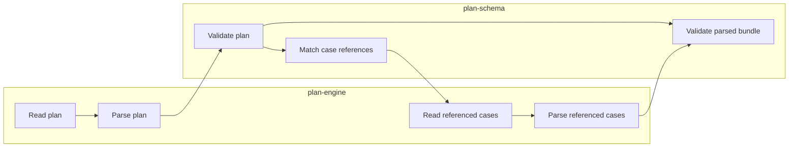

# Lesson 1: Loading plans and cases

> “How does `loadPlanFile` turn a plan path into an ordered, validated set of documents?” — Liam “Loading Learner” Lane, Developer

`plan-engine` owns Node.js file access. It reads and parses the plan, asks `plan-schema` to validate it, processes only the referenced cases, and returns either a success value or structured issues. Each loaded case retains its `caseIndex` and original reference so errors do not lose their source.

Unreferenced files are not read. Successful loading means the source is ready for later work; no browser steps have run.

## Try it

Add an unreferenced malformed JSON file beside a plan, then make a referenced case malformed. Explain why only the second change matters.

## You are ready when

- You can trace one reference from the plan to its parsed case.
- You can explain why browser execution is outside this package.

