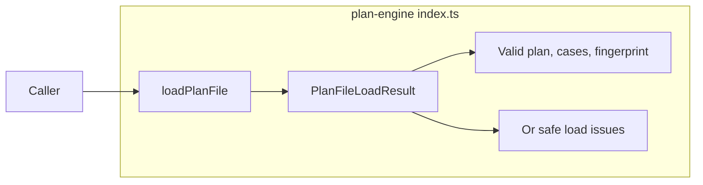

# Lesson 5: Public API anatomy

> “Which part of plan-engine can another package actually call?” — Perry “Public Path” Patel, Developer

[← Previous: source fingerprints](04-fingerprints.md) · [Course outline](../README.md) · [Next: course skill check →](../quiz.md)

`src/index.ts` is the package front desk. Other packages import from it instead of reaching into private files. Plan-engine has one callable public function and several exported result shapes.



## Functions

| Function | What it does | Input | Output |
| --- | --- | --- | --- |
| `loadPlanFile` | Reads a plan and its referenced cases, then validates and fingerprints them. | A plan-file path. | A promise containing either a valid bundle or issues. |

## Types

| Type | What it describes | Input | Output |
| --- | --- | --- | --- |
| `PlanFileLoadResult` | Describes the two possible outcomes. | Used as the function result type. | Valid data or a list of issues. |
| `LoadedCaseFile` | Describes one loaded case and its place in the plan. | Used inside a valid result. | Case index, reference, normalized path, and parsed value. |
| `PlanSourceFingerprint` | Describes the exact loaded source revision. | Used inside a valid result. | `sha256-v1` algorithm and digest. |
| `PlanLoadIssue` | Describes one safe loading or validation problem. | Used inside an invalid result. | Path, rule keyword, message, and optional reference. |

```ts
import { loadPlanFile } from "@stagehand/plan-engine";

const loaded = await loadPlanFile("plans/checkout.plan.json");
if (loaded.valid) {
  console.log(loaded.fingerprint.digest);
} else {
  console.log(loaded.issues);
}
```

The `valid` check is important. It tells TypeScript, and the reader, which half of the result is available. Do not assume `plan`, `cases`, or `fingerprint` exist after a failed load.

## Try it

Read `src/index.ts`. Find `loadPlanFile`, then trace one returned `PlanLoadIssue` back to the helper that creates it.

## You are ready when

- You can name the only callable plan-engine export.
- You can explain why callers check `valid` before using a loaded plan.
- You can distinguish a loaded case from its fingerprint and its issue list.

[← Previous: source fingerprints](04-fingerprints.md) · [Course outline](../README.md) · [Next: course skill check →](../quiz.md)
