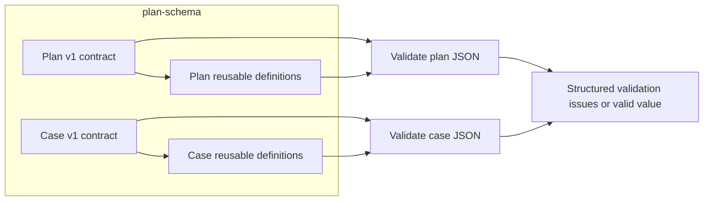

# Lesson 1: Contracts

> “What promise does `plan-schema` make about Stagehand documents?” — Connie “Contract Curious” Carter, Developer

[← Previous: course outline](../README.md) · [Course outline](../README.md) · [Next: plan schema anatomy →](02-plan-schema-anatomy.md)

A **contract** is an agreed shape and meaning. It says which fields a plan or case must have, what each field may contain, and which combinations are invalid. Stagehand's plan and case contracts live in [`plan-v1.schema.json`](../../../../packages/plan-schema/src/plan-v1.schema.json) and [`case-v1.schema.json`](../../../../packages/plan-schema/src/case-v1.schema.json).

Stagehand currently has one plan/case contract version: **version 1**. The `version` property identifies this version in every plan and case document. To control which versions are accepted, the schema defines the allowed value for that property; currently, only `1` is supported. The v1 contracts can still evolve while the milestone work continues. A milestone release is the point to make a deliberate compatibility/versioning decision.

The contracts are written using **JSON Schema Draft 2020-12**. That is not a second Stagehand version. It is the standard rule language used to describe JSON structures.

Each contract has its own `$defs` section: a labelled collection of reusable definitions such as browser settings, variable definitions, locators, and step building blocks. `$ref` means “use that definition here.” For example, a case step can `$ref` its schema's locator definition instead of copying the locator rules into every step type.

Here are the main Draft 2020-12 words you will meet in Stagehand:

| Rule | Plain-language meaning | Stagehand example and business meaning |
| --- | --- | --- |
| `type` | What kind of value is allowed. | A case is an `object`; `steps` is an `array`; a timeout is an `integer`. This prevents a plan from using a number where the runner needs a list of steps. |
| `properties` | The named fields allowed inside an object. | A case may contain `id`, `steps`, `variables`, and settings. These names are the vocabulary Stagehand understands. |
| `required` | Fields that must be present. | Every case needs `version`, `id`, and `steps`; without them, Stagehand cannot identify or run the case. |
| `const` | One exact permitted value. | `version` must be `1`; action-specific rules also use it to say a step is exactly `click` or `assertText`. |
| `$defs` and `$ref` | Store a named reusable rule, then use it elsewhere. | One locator rule is reused by clicks, typing, filling, selection, and assertions, keeping their meaning consistent. |
| `oneOf` | The value must match exactly one of several alternatives. | A step is one recognised action type; a locator is one of role, label, CSS, or XPath. This prevents ambiguous mixed forms. |
| `allOf` | The value must satisfy every listed group of rules. | An interaction step combines shared timeout/wait rules with its own action-specific rules. |
| `additionalProperties: false` or `unevaluatedProperties: false` | Unrecognised fields are rejected. | A misspelling such as `timout` does not silently do nothing. This is especially important for test settings that affect browser behaviour. |

These structural rules express product meaning that is safe to check from the JSON alone: a case has ordered steps, a `click` needs a locator, and a shared-step call needs its stable ID. Some meaning needs more than structural rules. `plan-schema` also runs semantic checks in TypeScript for rules such as valid locale tags, supported time zones, canonical duplicate locale keys, and absolute HTTP/HTTPS navigation URLs.

The contract still does not read a file, find a browser element, or prove a test will succeed. Those jobs belong to other packages: `plan-engine` handles files and `runner-core` handles browser execution.

## Try it

Find the required top-level fields in both schemas. Then trace one `$ref` from a step definition to its `$defs` rule and explain what business mistake that reused rule prevents.

## You are ready when

- You can explain why Stagehand currently has one v1 plan/case contract while Draft 2020-12 is the rule language.
- You can explain `$defs`, `$ref`, `oneOf`, `allOf`, and `required` in plain language.
- You can connect a structural rule to the testing mistake it prevents.
- You can explain why a valid document is not necessarily executable.

[← Previous: course outline](../README.md) · [Course outline](../README.md) · [Next: plan schema anatomy →](02-plan-schema-anatomy.md)
