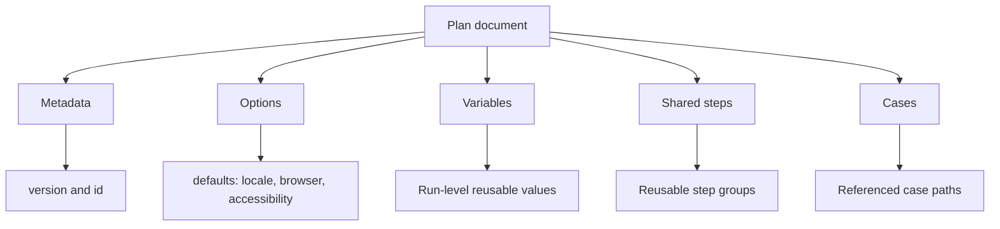

# Lesson 2: Anatomy of the plan schema

> “Which parts of a plan describe the run, and which parts point to the work it will perform?” — Penny “Plan Parts” Parker, Developer

[← Previous: contracts](01-contracts.md) · [Course outline](../README.md) · [Next: case schema anatomy →](03-case-schema-anatomy.md)

A plan is the run-level document. Its major property groupings answer different business questions:

- **Metadata** identifies the document. `version` selects the accepted contract, while `id` gives the plan a stable human-facing identity.
- **Options** live in `defaults`. They set run-wide starting choices such as locale, browser settings, and accessibility settings. Cases may override only the settings the case schema allows.
- **Variables** are plan-level fixed inputs. A case or step may replace a same-named definition with a narrower one.
- **Shared steps** live in `sharedSteps`. They define one-level reusable groups that cases can call by stable ID.
- **Cases** is the ordered list of relative paths to case files. The plan does not embed whole case documents.

There is no `dataSets` property at plan level in the current contract. A case may contribute named data sets, and bundle validation combines those case contributions into the plan's available data-set collection. Lesson 8 explains that relationship.

## Try it

Open `plan-v1.schema.json`. Find each top-level property in the diagram and state whether it identifies the plan, sets a default, supplies an input, provides reuse, or points to a case.

## You are ready when

- You can distinguish plan metadata, defaults, variables, shared steps, and case references.
- You know that current named data sets originate in cases, not in a `plan.dataSets` property.
- You can explain why a plan points to cases rather than embedding them.

[← Previous: contracts](01-contracts.md) · [Course outline](../README.md) · [Next: case schema anatomy →](03-case-schema-anatomy.md)
