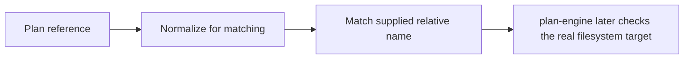

# Lesson 3: Case references

> “How does a plan reference get matched to an available case file name?” — Riley “Reference Ranger” Reed, Developer

`matchCaseReferences` compares the plan's relative case paths with relative paths supplied by a caller. It normalizes repeated `/` and `.` segments, matches case-sensitively, and reports missing, ambiguous, escaping, and duplicate references.

The normalized path is only a matching label. It is not proof that a real file stays inside a directory. A filesystem link can change where a path leads, so canonical containment belongs to Node-side `plan-engine`.

The first three boxes are logical matching. The final box is filesystem safety; neither replaces the other.

## Try it

Compare `cases/./sign-in.json` with `cases/sign-in.json`, then compare `Cases/sign-in.json`. Explain the different outcomes.

## You are ready when

- You can explain why matching is case-sensitive.
- You know why normalized text cannot prove filesystem containment.

