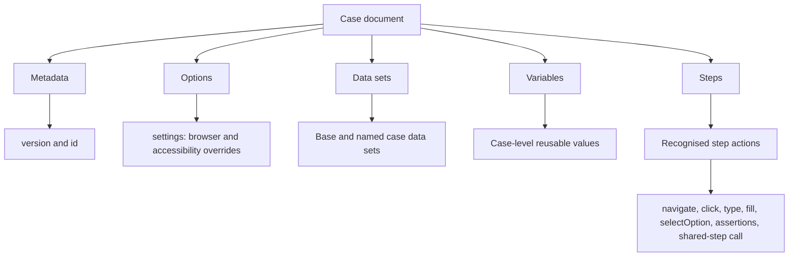

# Lesson 3: Anatomy of the case schema

> “How does a case describe one test without mixing up its settings, inputs, and actions?” — Casey “Case Cartographer” Chen, Developer

[← Previous: plan schema anatomy](02-plan-schema-anatomy.md) · [Course outline](../README.md) · [Next: validation →](04-validation.md)

A case is one ordered test. It carries the information needed to run that test, while the plan supplies the wider run context.

- **Metadata** is `version` and `id`. The ID distinguishes this case from the others referenced by its plan.
- **Options** live in `settings`. They allow the supported case-level browser and accessibility overrides; they do not change run-wide headless mode or locale.
- **Data sets** contain a base `default` set and optional named sets. A selected named set layers over `default`.
- **Variables** are case-level inputs. A step can replace one; a selected data set can take precedence over one with the same name.
- **Steps** are the ordered browser instructions. The schema uses `oneOf` to require one recognised action shape per step. A shared-step call is a marker that becomes ordinary steps during later preparation.

## Try it

Open `case-v1.schema.json`. Pick one `type` step and identify which part comes from shared interaction rules and which part is unique to typing.

## You are ready when

- You can locate a case's metadata, settings, data sets, variables, and steps.
- You can explain why a step must match one recognised action shape.
- You can distinguish a shared-step call marker from a browser action.

[← Previous: plan schema anatomy](02-plan-schema-anatomy.md) · [Course outline](../README.md) · [Next: validation →](04-validation.md)
