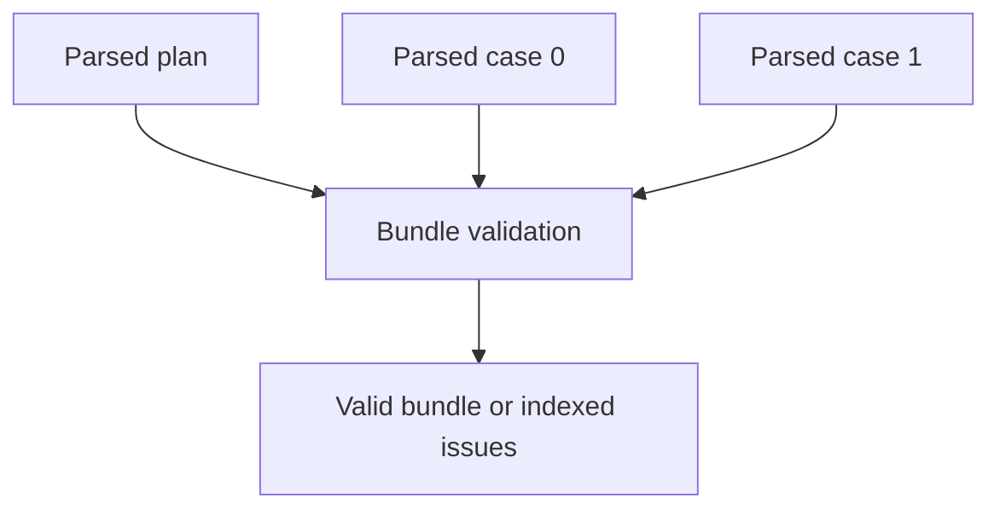

# Lesson 4: Bundle validation

> “What can Stagehand check only after the plan and all referenced cases are available together?” — Bonnie “Bundle Builder” Brooks, Developer

A **bundle** is the parsed plan plus its parsed cases in plan-reference order. `validatePlanBundle` checks each document, requires one case per reference, and detects relationships that one file cannot prove alone: duplicate case IDs, duplicate data-set names across cases, and a `defaultDataSet` that names no contributed set.

Issue paths begin with `/caseFiles/{index}` so the caller can connect an error to the matching plan reference. Bundle validation still does not read files or execute steps.

## Try it

Create two synthetic cases with the same ID, then with different IDs but the same data-set name. Compare the issue paths.

## You are ready when

- You can name a rule that requires the complete bundle.
- You can explain why case order must match plan-reference order.

