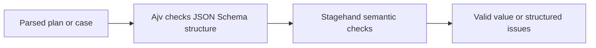

# Lesson 4: Validation

> “How does Stagehand decide whether one plan or case value is valid?” — Valerie “Validation Voyager” Vaughn, Developer

[← Previous: case schema anatomy](03-case-schema-anatomy.md) · [Course outline](../README.md) · [Next: case references →](05-case-references.md)

`validatePlan` and `validateCase` accept an already parsed JavaScript value. They return `{ valid: true }` or `{ valid: false, issues }`; ordinary invalid input is reported as data rather than thrown as an exception.

**Ajv** is a JavaScript library that reads JSON Schema rules and turns them into a validator function. In Stagehand, it checks the plan or case against its v1 schema: required fields, allowed properties, types, recognised step shapes, and other structure rules. Think of Ajv as the rule-reader, not as the source of Stagehand's product decisions.

Stagehand then adds checks that are clearer in code, such as valid locale tags, supported time zones, canonical duplicate locale keys, and absolute HTTP/HTTPS navigation URLs. These are called **semantic checks**: they check meaning that goes beyond basic JSON shape.

Ajv and Stagehand's semantic checks work together. A field may have the right JSON type but still be unsuitable for a browser test, such as an `ftp:` navigation URL.

An issue contains a JSON Pointer path, keyword, and message. A path such as `/steps/2/url` is a precise trail to the failing value—like an aisle, shelf, and item number.

## Try it

Run `npm test --workspace @stagehand/plan-schema`. Change a copy of a navigation URL to `ftp://example.test` and predict the issue path before validating it.

## You are ready when

- You can explain schema checks versus semantic checks.
- You can explain Ajv's job without confusing it with Stagehand's business rules.
- You can use an issue path to find the failing value.

[← Previous: case schema anatomy](03-case-schema-anatomy.md) · [Course outline](../README.md) · [Next: case references →](05-case-references.md)
