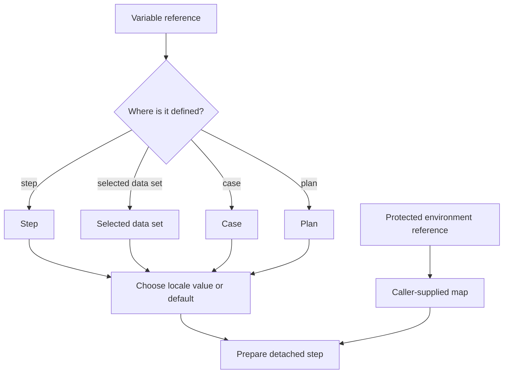

# Lesson 5: Variables

> “How are ordinary reusable values defined, chosen, and placed into a case step?” — Victor “Variable Virtuoso” Vega, Developer

An ordinary variable definition has a required text, number, or boolean `default` and optional same-type locale values. A text definition may instead use `{ "env": "NAME" }`, which names a future environment source without storing its value. Number and boolean definitions cannot use this form. Names are case-sensitive. The narrower scope wins: step, then selected data set, then case, then plan. The winning definition replaces the whole broader definition; locale maps are not merged.

A step refers to a value with a whole-field object such as `{ "var": "email" }`. Ordinary strings stay literal. `resolveVariable` chooses a definition and locale/default value. `resolveProtectedEnvironmentValue` looks up only an already-selected protected name from a caller-supplied map: an empty value counts as supplied, while a missing name fails clearly. It does not read `process.env`. `prepareCaseStep` and `prepareCase` replace ordinary supported references in detached copies, converting numbers and booleans to text only for text destinations. When given that same map, preparation can replace a selected protected value and return it separately for a caller-owned redaction boundary.

Think of scope as stacked instruction cards: use the topmost card that names the value, then read only that card.

Read the scope boxes from top to bottom: the first definition found wins completely. The protected-value branch is separate because only a caller can supply its text.

## Try it

Define `greeting` at plan and case scope with different locale maps. Predict the value for `fr-CA` when the case definition has no `fr-CA` entry.

## You are ready when

- You can state the scope order and whole-definition replacement rule.
- You know why `${email}` is literal text rather than interpolation.
- You can explain why protected values must be passed separately to a redaction boundary.
- You can explain why a supplied-map lookup is not direct process-environment access.

