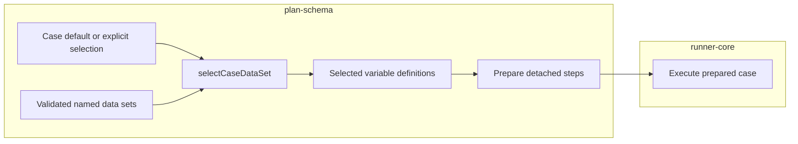

# Lesson 6: Data sets

> “How does a case choose the right named data set without starting a browser?” — Dana “Data-set Detective” Doyle, Developer

A case may contribute `dataSets`. Each entry has a case-sensitive `name` and `variables` using the ordinary scalar definition shape. A case may name its fallback with `defaultDataSet`.

```json
{
  "dataSets": [
    { "name": "standard", "variables": { "email": { "default": "tester@example.invalid" } } }
  ],
  "defaultDataSet": "standard"
}
```

Case validation rejects malformed definitions and duplicate names inside one case. Bundle validation rejects names duplicated across cases and unknown default names.

`selectCaseDataSet` takes one case, the validated bundle's named data-set collection, and optionally an explicit selection for that case. It uses the explicit name when supplied; otherwise it uses `defaultDataSet`. An unknown name returns a clear failure before browser work begins. The selected definitions sit below step variables but above same-named case and plan variables during pure resolution and preparation.

The helper only calculates the selected definitions. Runner-core receives the validated collection and optional per-case selection at its `executeCase` boundary; a browser-free run-preparation helper can apply the same selection before browser startup.



Selection chooses values; it does not itself start a browser or execute a case.

## Try it

Explain how a case with `defaultDataSet: "standard"` differs from the same case when an explicit `"regional"` selection is supplied. Then identify which one wins if a step, the selected set, the case, and the plan all define `email`.

## You are ready when

- You can describe the accepted JSON shape.
- You can explain default versus explicit selection and the scope order.
- You do not confuse pure selection with runner integration.

