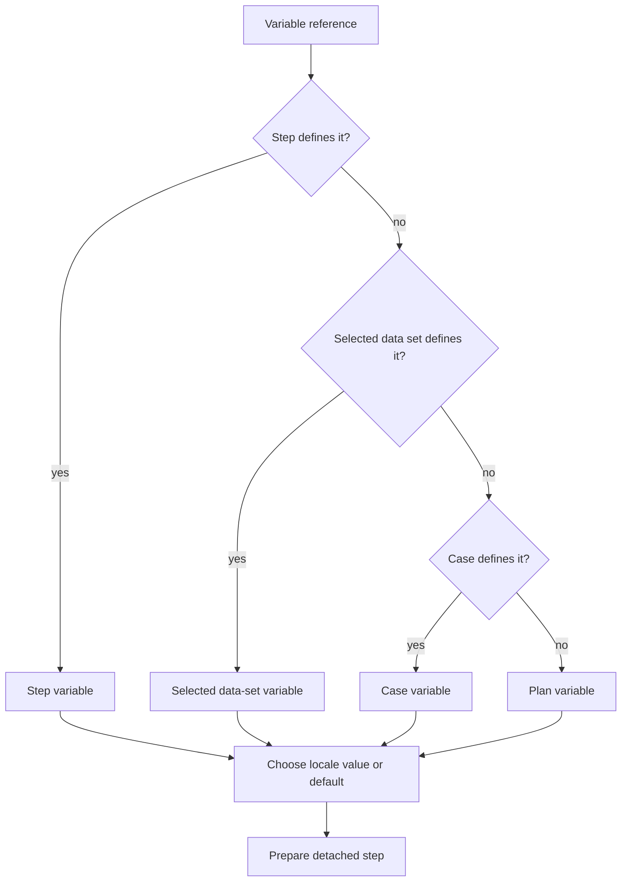

# Lesson 7: Variables

> “How are reusable values named, selected, and safely placed into a case step?” — Victor “Variable Virtuoso” Vega, Developer

[← Previous: bundle validation](06-bundle-validation.md) · [Course outline](../README.md) · [Next: data sets →](08-data-sets.md)


A variable is a named fixed input. It lets an author reuse a value such as an email address, retry count, or feature flag without copying it into every step.

## Names and ordinary values

Variable names are non-empty and case-sensitive. `email`, `Email`, and `EMAIL` are three different names. A step uses a variable only with a whole-field reference such as `{ "var": "email" }`; ordinary text such as `${email}` remains ordinary text.

An ordinary variable has a required `default` and may have locale-specific values. All values in one definition must have the same basic type.

| Type | What it represents | Example definition |
| --- | --- | --- |
| String | Text such as an email address or URL. | `{ "default": "tester@example.invalid" }` |
| Number | A numeric value such as a retry count. | `{ "default": 3 }` |
| Boolean | A true/false choice such as a feature flag. | `{ "default": true }` |

Inside a plan, case, or step, the definitions sit under a `variables` property:

```json
{
  "variables": {
    "email": { "default": "tester@example.invalid" },
    "retryCount": { "default": 3 },
    "showHints": { "default": true }
  }
}
```

When a number or boolean is used in a text destination such as `type.text` or an assertion's expected text, preparation converts it to text. Otherwise, its type is preserved.

## Locale values

`locales` lets one definition supply a different same-type value for a run locale:

```json
{
  "default": "Sign in",
  "locales": { "fr-CA": "Ouvrir une session" }
}
```

For a `fr-CA` run, the example selects `Ouvrir une session`; other locales use `Sign in`. If a narrower definition wins by scope, it replaces the complete broader definition. Its locale map is not merged with the broader one.

## Protected environment values

A text definition may use a protected environment reference instead of literal text:

```json
{ "default": { "env": "TEST_PASSWORD" } }
```

This stores only the environment-variable name in JSON. Number and boolean definitions cannot use this form. `resolveEnvironmentValue` looks up only the selected name in a caller-supplied map: an empty value counts as supplied, while a missing name fails clearly. It does not read `process.env`. When preparation uses that map, it returns the resolved value separately so a caller can redact retained evidence.

## Scope and selection

The narrowest definition wins: step, selected data set, case, then plan. `resolveVariable` selects the winning definition, chooses its locale value or default, and `prepareCaseStep` or `prepareCase` places the value into a detached copy of the supported step field.



The checks are ordered, not combined: a data-set definition is considered only when no step definition exists, and so on.

## Try it

Define `greeting` at plan and case scope with different locale maps. Predict the value for `fr-CA` when the case definition has no `fr-CA` entry. Then define `attempts` as a number and predict its prepared value in a `type` step.

## You are ready when

- You can state the case-sensitive naming rule and recognise a whole-field variable reference.
- You can distinguish string, number, and boolean definitions.
- You can explain same-type locale variants and whole-definition replacement.
- You can distinguish a protected environment reference from a literal text value.
- You can state the scope order and explain why the first match wins.

[← Previous: bundle validation](06-bundle-validation.md) · [Course outline](../README.md) · [Next: data sets →](08-data-sets.md)
