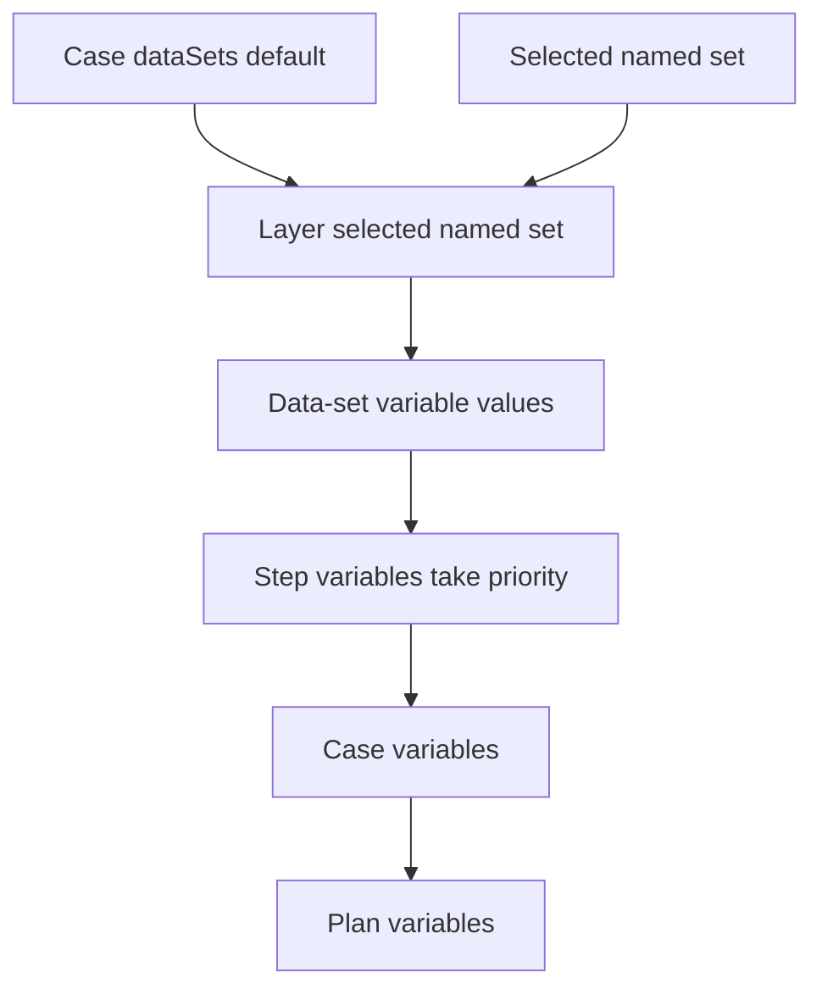

# Lesson 8: Data sets

> “How can I change only the test inputs that differ?” — Dana “Data-set Detective” Doyle, Developer

[← Previous: variables](07-variables.md) · [Course outline](../README.md) · [Next: shared steps →](09-shared-steps.md)


## Where data sets live

The current contract has **case-level data sets only**. A plan has no `dataSets` property. Each case can define a base set and contribute named sets. Plan-wide reusable values are ordinary `variables`.

## Anatomy and layering

`dataSets.default` is the base set. Each other property is a named set. Its values layer over the base, so it only needs to contain the values that change.

```json
{
  "dataSets": {
    "default": {
      "email": { "default": "tester@example.invalid" },
      "retryCount": { "default": 3 }
    },
    "regional": {
      "email": { "default": "tester-ca@example.invalid" }
    }
  }
}
```

Selecting `regional` uses its email address and the default retry count. Variable definitions still use the string, number, boolean, locale, and environment-reference rules from the previous lesson.

## Selection and scope

`selectCaseDataSet` returns the base set when no name is selected. With an explicit selection, it finds that named set in the validated bundle and layers it over the base. An unknown name fails before browser work begins.



For a requested variable, a step definition wins first, then the layered data-set value, then the case and plan definitions. A selected variable replaces a same-named base definition; locale values are not merged between definitions.

## Try it

Using the example, state the email address and retry count when `regional` is selected. Then identify which value wins if a step, selected set, case, and plan all define `email`.

## You are ready when

- You know that data sets are case-level.
- You can explain `default` and named-set layering.
- You can describe explicit selection and its pre-browser failure.
- You can state where data-set variables sit in scope order.

[← Previous: variables](07-variables.md) · [Course outline](../README.md) · [Next: shared steps →](09-shared-steps.md)
