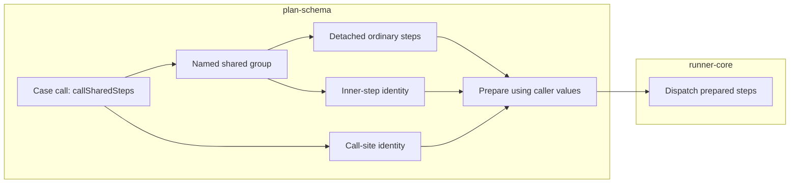

# Lesson 8: Shared-step expansion

> “How does one shared-step call become ordinary steps without losing its history?” — Evan “Expansion Explorer” Ellis, Developer

`expandCaseSharedSteps` replaces each `callSharedSteps` marker with detached copies of its group's steps. It preserves both sides of the story: the calling case-step index and the group ID, group index, and inner-step index.

`prepareCaseSharedSteps` then resolves variables using the calling case's variables and selected data-set values. A group has no private variables, so it cannot quietly change the caller's inputs.

Think of expansion as replacing a bookmark with a photocopy of the bookmarked page while writing the bookmark location in the margin. The copied steps can run later, but the margin still says where they came from.

These helpers do not start a browser or dispatch a step. Runner-core now receives their prepared detached steps and dispatches them at its case-session boundary.

Expansion copies the group steps, while the two identity notes travel with those copies so later failures can still explain where the work came from.

## Try it

Put a `callSharedSteps` marker between two ordinary steps. Predict the expanded order and the identity recorded for each copied group step.

## You are ready when

- You can explain why detached copies prevent one expansion from changing another.
- You can identify both the call site and the inner shared step after expansion.
- You distinguish pure preparation from browser execution.
