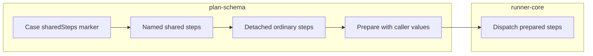

# Lesson 9: Shared steps

> “How can a case reuse named steps while keeping its values and errors clear?” — Greta “Group Guardian” Grant, Developer

[← Previous: data sets](08-data-sets.md) · [Course outline](../README.md) · [Next: course skill check →](../quiz.md)


Shared steps are plan-level reusable steps. A case calls one by ID; preparation replaces that call with detached ordinary steps in execution order.

## Anatomy of shared steps

The plan owns `sharedSteps`. Each key is the shared-step ID and its value is the list of steps.

```json
{
  "sharedSteps": {
    "signIn": [
      { "action": "fill", "locator": { "css": "#email" }, "value": { "var": "email" } },
      { "action": "click", "locator": { "role": "button", "name": "Sign in" } }
    ]
  }
}
```

A case calls those steps with an ordinary step-shaped marker:

```json
{ "action": "sharedSteps", "id": "signIn" }
```

The schema rejects an unknown call, a call inside shared steps, and private variables inside shared steps. The shared steps use the calling case's values.

## Expansion and traceability

`expandCaseSharedSteps` copies the named steps into the case. `prepareCaseSharedSteps` resolves those copies with the calling case's variables and selected data set. A copied step retains its calling case-step index, shared-step ID, and inner-step index.



## Try it

Write `signIn` with two steps and place its marker between two ordinary case steps. Predict the expanded order and the identity reported if its second step fails.

## You are ready when

- You can identify the plan definition and case marker.
- You know why nested shared steps and private variables are rejected.
- You can explain detached expansion and retained identity.

[← Previous: data sets](08-data-sets.md) · [Course outline](../README.md) · [Next: course skill check →](../quiz.md)
