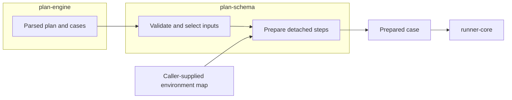

# Course: Understanding `@stagehand/plan-schema`

This course teaches how Stagehand describes valid plan and case documents, checks them, and prepares ordinary variable values. The [package README](../../../packages/plan-schema/README.md) remains the detailed implementation reference.

## In this course you will learn

- What a Stagehand document contract promises.
- How single-document, reference, and bundle validation differ.
- How variables, named data sets, and shared steps are validated and prepared.
- What this package deliberately leaves to file loading and browser execution.

## Do I need this course?

- [ ] I review changes to plan or case JSON.
- [ ] I need to understand a validation error path.
- [ ] I am changing variables, data sets, references, or schema versions.
- [ ] I need to know whether a rule belongs in `plan-schema`, `plan-engine`, or `runner-core`.

If you checked any item, this course is relevant.

## Current boundary

The package validates v1 plan/case shapes, semantic locale/time-zone/URL rules, case references, parsed bundles, variable definitions, data sets, and shared steps. Case `dataSets.default` provides base values; a selected named set layers its changes over that base. It expands `{ "action": "sharedSteps", "id": "..." }` calls with source identity, then prepares variable references using the calling case's selected context. An `{ "env": "NAME" }` reference remains unresolved until a caller supplies an environment map; preparation returns effective values separately for caller-owned redaction. The package does not read files, execute shared steps, read `process.env`, or start a browser. The current development-container suite passes 71 tests.

The package is the rules desk between authored JSON and browser execution. It receives parsed values and optional selected environment values; it never reads files or starts a browser itself.

## Lessons

1. [Contracts](Lessons/01-contracts.md)
2. [Anatomy of the plan schema](Lessons/02-plan-schema-anatomy.md)
3. [Anatomy of the case schema](Lessons/03-case-schema-anatomy.md)
4. [Validation](Lessons/04-validation.md)
5. [Case references](Lessons/05-case-references.md)
6. [Bundle validation](Lessons/06-bundle-validation.md)
7. [Variables](Lessons/07-variables.md)
8. [Data sets](Lessons/08-data-sets.md)
9. [Shared steps](Lessons/09-shared-steps.md)
10. [Public API anatomy](Lessons/10-public-api.md)

Finish with the [course skill check](quiz.md).
