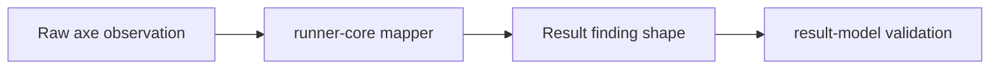

# Lesson 4: Accessibility evidence

> “What accessibility information can a result retain without storing every raw axe detail?” — Avery “Accessibility Archivist” Ames, Developer

Every case records effective accessibility settings: `enabled`, `failOnViolation`, and resolved `tags`. This records assessment scope even when no findings exist. Finding tags describe the reported rule; they are not the same as the configured scope.

Each finding retains its URL, rule information, affected nodes, and a node count. Nodes retain selected evidence: HTML, structured target paths, related nodes, and optional impact, failure summary, and XPath. Structured target arrays preserve frame and shadow-DOM boundaries.

The mapper selects and transforms evidence; this package validates the resulting shape. A valid result does not prove the scan itself was complete.

## Try it

Compare configured tags with one finding's tags. Explain why both must be retained.

## You are ready when

- You can distinguish assessment scope from rule tags.
- You can name the selected node evidence and explain structured targets.

