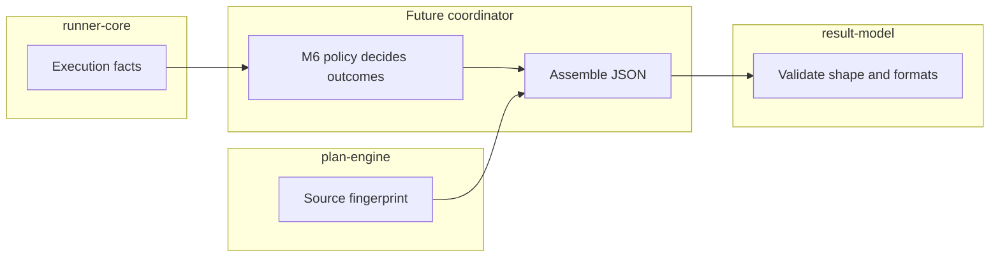

# Lesson 5: Structure versus execution policy

> “Which result rules belong here, and which belong to execution policy?” — Polly “Policy Partitioner” Parks, Developer

[← Previous: accessibility evidence](04-accessibility-evidence.md) · [Course outline](../README.md) · [Next: redaction foundation →](06-redaction-foundation.md)

This package answers “Does this value have the agreed result shape?” It does not answer “Should these failures make the run fail?” or “Do these counts correctly summarize every case?” Those are cross-field and behavioural decisions owned by M6.

Other boundaries matter too:

- `plan-engine` calculates the source fingerprint.
- `runner-core` scans and maps accessibility observations.
- A future result producer assembles the complete document.
- `result-model` validates the assembled shape.

This division prevents a schema validator from quietly inventing execution rules.

The arrows show a hand-off, not current complete run behaviour. `result-model` is last in this flow because it checks the document after another component has assembled it.

## Try it

Classify these proposed checks: valid URI format, case counts equal actual outcomes, required finding URL, fail-on-violation changes run status.

## You are ready when

- You can separate shape/format rules from aggregation/status policy.
- You know that this package validates but does not produce results.

[← Previous: accessibility evidence](04-accessibility-evidence.md) · [Course outline](../README.md) · [Next: redaction foundation →](06-redaction-foundation.md)
