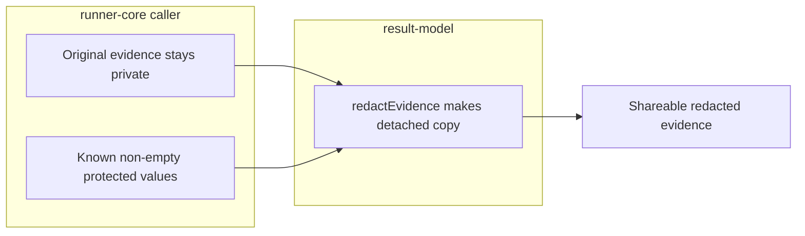

# Lesson 6: Redaction foundation

> “How can Stagehand hide a protected value without changing the useful shape of its evidence?” — Rowan “Redaction Ranger” Reed, Developer

[← Previous: policy boundary](05-policy-boundary.md) · [Course outline](../README.md) · [Next: public API anatomy →](07-public-api.md)

`redactEvidence(evidence, protectedValues)` makes a separate copy of JSON-like evidence and replaces each supplied, non-empty protected value with `[REDACTED]`. It works through nested strings, so it can cover diagnostic messages, assertion details, URLs, markup, selectors, summaries, tags, related nodes, and supplied raw scan records.

Think of it as a careful editor making a photocopy for sharing: the editor blacks out a known value but leaves the rest of the page readable. It does not guess which values are secret, read environment variables, or change the original evidence.

Runner-core now supplies effective protected values when `executeCase` retains soft-failure and automatic scan evidence, and direct scans can receive caller-supplied protected values. This helper remains only the redaction mechanism: it does not identify secrets or make every runner API safe by default.

The original and shareable copies are deliberately separate. That lets execution use the real value while retained evidence hides it.

## Try it

Use a synthetic value such as `not-a-real-password` in a nested HTML string and a URL. Predict the two redacted strings without changing the original object.

## You are ready when

- You can explain why empty strings are not redacted.
- You can state why a detached redacted copy is safer for evidence sharing.
- You can distinguish this helper from protected-value environment lookup and runner integration.

[← Previous: policy boundary](05-policy-boundary.md) · [Course outline](../README.md) · [Next: public API anatomy →](07-public-api.md)
