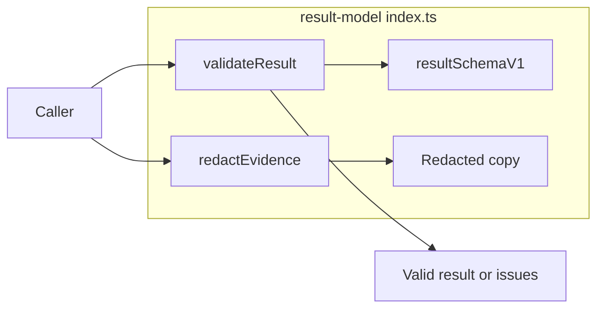

# Lesson 7: Public API anatomy

> “How do I use result-model without depending on its private wiring?” — Rita “Result Reader” Roy, Developer

[← Previous: redaction foundation](06-redaction-foundation.md) · [Course outline](../README.md) · [Next: course skill check →](../quiz.md)

`src/index.ts` is result-model’s public counter. It exposes the contract, the checker, the redaction helper, and TypeScript names that describe result data. It does not create a result; runner-core’s adapter does that work.



## Functions

| Function | What it does | Input | Output |
| --- | --- | --- | --- |
| `validateResult` | Checks an unknown value against the result contract. | Any value. | `{ valid: true }` or `{ valid: false, issues }`. |
| `redactEvidence` | Makes a detached copy with supplied protected text replaced. | JSON-like evidence and protected values. | Same-shaped redacted copy. |

## Types

| Type or value | What it describes | Input | Output |
| --- | --- | --- | --- |
| Result types | Describe result documents, diagnostics, findings, and validation results for TypeScript. | Used while writing code. | Compile-time checking rather than runtime work. |

The public value `resultSchemaV1` is the version 1 JSON Schema object. `REDACTED_EVIDENCE_VALUE` is the `[REDACTED]` replacement text used by redaction.

```ts
import { redactEvidence, validateResult } from "@stagehand/result-model";

const safeCopy = redactEvidence({ message: "password: not-a-real-password" }, ["not-a-real-password"]);
const check = validateResult(safeCopy);
console.log(check.valid);
```

The example is intentionally incomplete as a result document, so validation returns issues. Redaction still works because it only needs JSON-like data, not a complete Stagehand result.

## Try it

Import `validateResult` and `redactEvidence` in a small test. Explain why one checks a document while the other copies evidence.

## You are ready when

- You can identify the callable validation and redaction exports.
- You can explain the difference between a runtime schema value and a TypeScript type.
- You know that result-model checks shape but does not decide execution outcomes.

[← Previous: redaction foundation](06-redaction-foundation.md) · [Course outline](../README.md) · [Next: course skill check →](../quiz.md)
