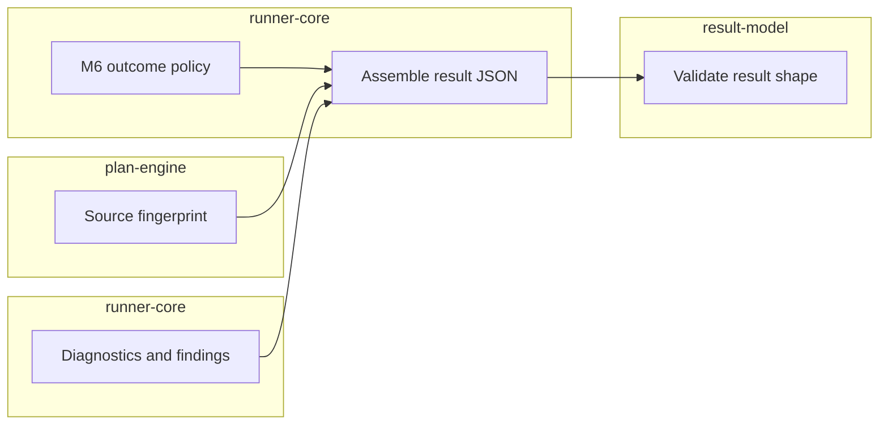

# Course: Understanding `@stagehand/result-model`

This course teaches the shape of Stagehand's saved run results and the difference between describing a result and deciding one. The [package README](../../../packages/result-model/README.md) is the implementation reference.

## In this course you will learn

- Why JSON Schema and TypeScript types both exist.
- How runtime result validation works.
- How accessibility evidence is represented.
- Which outcome and aggregation rules remain outside this package.
- How the redaction helper prepares evidence sharing without enabling protected execution.

## Do I need this course?

- [ ] I am changing the result JSON format or its TypeScript types.
- [ ] I need to interpret a `validateResult` issue.
- [ ] I am mapping accessibility findings into saved evidence.
- [ ] I need to separate result structure from execution policy.

## Current boundary

The package exports the normative result v1 schema, matching TypeScript types, a runtime validator, and a pure redaction helper. It checks document shape and formats. The helper redacts supplied values from a detached JSON-like copy; it does not identify secrets or protect runner history on its own. The package does not calculate fingerprints, assemble results, scan pages, or decide case/run outcomes.

`result-model` is the final shape checker, not the writer or judge. Runner-core supplies the outcome decision and assembles the in-memory document; this package checks the assembled JSON.

## Lessons

1. [The result contract](Lessons/01-result-contract.md)
2. [Schema and TypeScript](Lessons/02-schema-and-types.md)
3. [Runtime validation](Lessons/03-runtime-validation.md)
4. [Accessibility evidence](Lessons/04-accessibility-evidence.md)
5. [Structure versus execution policy](Lessons/05-policy-boundary.md)
6. [Redaction foundation](Lessons/06-redaction-foundation.md)
7. [Public API anatomy](Lessons/07-public-api.md)

Finish with the [course skill check](quiz.md).
