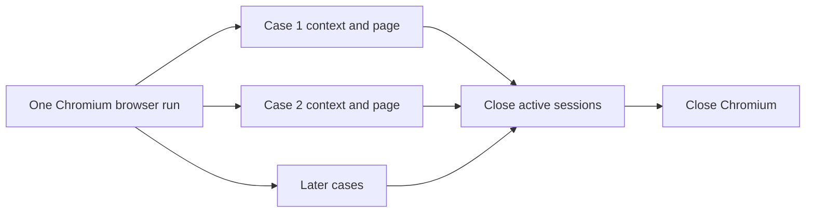

# Lesson 1: Browser lifecycle

> “How does one Stagehand browser run safely manage isolated case sessions?” — Brenda “Browser Boss” Blake, Developer

[← Previous: course outline](../README.md) · [Course outline](../README.md) · [Next: locators →](02-locators.md)

`startBrowserRun` launches one Playwright-managed Chromium process. Each case session receives a separate browser context and page—like separate hotel rooms inside one building. The rooms isolate cookies and page state; the shared building explains why headless mode belongs to the whole run.

Run settings provide locale, headless mode, viewport, time zone, and accessibility defaults. Cases may override viewport, time zone, and accessibility settings, but not run-wide locale or headless mode.

Closing a run waits for case-session setup already in progress, closes active sessions, and then closes Chromium. Cleanup belongs in `finally` blocks so it still runs after failures.

Contexts are private rooms in the same browser building: cases share the Chromium process but not cookies or page state. Closing works in the reverse direction, from sessions back to the shared browser.

## Try it

Trace [`browser/run.ts`](../../../../packages/runner-core/src/browser/run.ts). Identify what happens when shutdown starts while a context is still being created.

## You are ready when

- You can explain browser process, context, page, and case isolation.
- You can describe coordinated shutdown and why cleanup is awaited.

[← Previous: course outline](../README.md) · [Course outline](../README.md) · [Next: locators →](02-locators.md)
