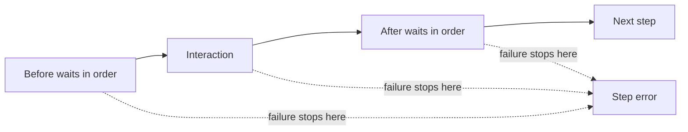

# Lesson 3: Waits

> “How does Stagehand pause predictably without allowing an unbounded wait?” — Wendy “Wait Watcher” Walsh, Developer

[← Previous: locators](02-locators.md) · [Course outline](../README.md) · [Next: actions →](04-actions.md)

Wait lists run in order. A wait may look for one locator, wait for `domcontentloaded` or `networkidle`, or use a fixed delay. Each item has a bounded timeout; delays are limited to 1–30,000 milliseconds.

Interaction steps may have `before` and `after` lists. Think of them as a checklist around the action: finish every “before” item, perform the action, then finish every “after” item.

There is no shortcut around a failed wait. Each successful box must finish before the next one begins.

## Try it

Create a paper sequence with a locator wait, click, fixed delay, and network-idle wait. Mark where a failure stops the sequence.

## You are ready when

- You can state the supported wait forms.
- You can explain ordering and timeout boundaries.

[← Previous: locators](02-locators.md) · [Course outline](../README.md) · [Next: actions →](04-actions.md)
