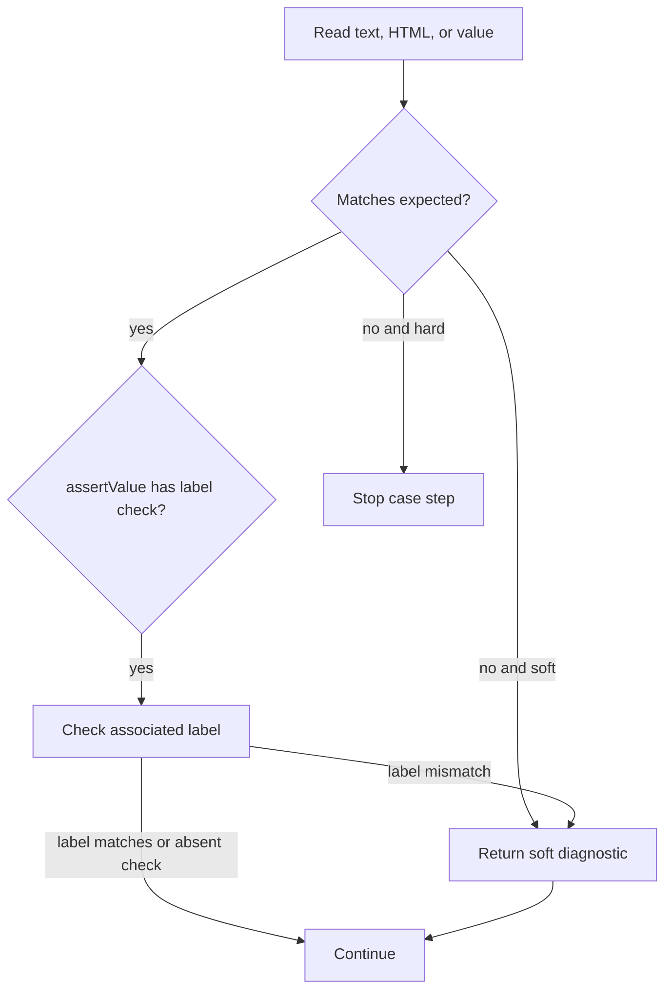

# Lesson 5: Assertions

> “How does runner-core compare page content and decide whether execution continues?” — Anita “Assertion Analyst” Abbott, Developer

[← Previous: actions](04-actions.md) · [Course outline](../README.md) · [Next: step dispatch →](06-step-dispatch.md)

`assertText`, `assertHtml`, and `assertValue` compare exact, case-sensitive strings selected for the run locale. They read inner text, inner HTML, and input value respectively. The timeout covers locator resolution and the read.

Assertions are hard by default: failure stops dispatch. With `soft: true`, expected mismatch, locator failure, or read timeout becomes a returned diagnostic and later steps continue. Unsafe browser errors remain hard.

`assertValue` can also check the control's standard HTML label association. Label failure is always soft. One step may therefore return both a soft value failure and a label failure; only the label diagnostic has `check: "associatedLabel"`.

A soft mismatch records useful evidence and lets the case continue. A hard mismatch stops normal dispatch; an unsafe browser problem is also hard.

## Try it

Predict the outcome for a soft value mismatch plus a missing label, then repeat with a hard value mismatch.

## You are ready when

- You can distinguish text, HTML, value, and label reads.
- You can explain hard, soft, and unsafe failures.

[← Previous: actions](04-actions.md) · [Course outline](../README.md) · [Next: step dispatch →](06-step-dispatch.md)
