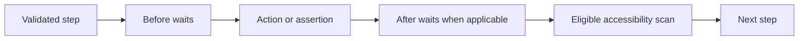

# Lesson 6: Step dispatch

> “How does runner-core execute a validated list of steps in the intended order?” — Johnny “JavaScript Junior” Jones, Developer

`executeSteps(caseId, steps)` visits the array from first to last and sends each recognized action to its handler. Interaction wait lists wrap their action. A hard failure becomes `StepExecutionError` with the case ID, zero-based step index, action, and original cause.

The scan is awaited before the next step. Result aggregation and case/run outcome policy are not calculated here.

## Try it

Trace a failed second step. Identify the error's index and explain why the third step does not run.

## You are ready when

- You can describe dispatch order and failure context.
- You know where automatic scanning fits in the sequence.

