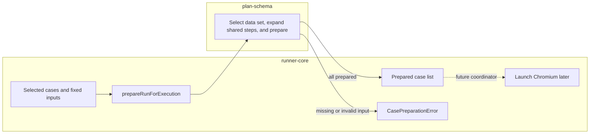

# Lesson 7: Case preparation

> “How are case inputs and shared steps prepared before the first step is dispatched?” — Casey “Case Composer” Cole, Developer

[← Previous: step dispatch](06-step-dispatch.md) · [Course outline](../README.md) · [Next: accessibility scans →](08-accessibility-scans.md)

`executeCase({ case, planVariables?, dataSets?, selectedDataSet?, sharedSteps?, environment? })` asks `plan-schema` for the case `dataSets.default` values, layers any explicit per-case data set over them, expands `sharedSteps` markers, then prepares detached steps using the run locale. Supported `{ "var": "name" }` references are replaced, and numbers/booleans become text for text destinations. The selected definitions sit below step variables but above same-named case and plan definitions. A caller-supplied `environment` map resolves selected `{ "env": "NAME" }` values; it is not `process.env`.

Preparation covers the whole case before dispatch starts. A `CasePreparationError` retains the case ID, source path, reason, message, and shared-step identity when applicable; no step from that call is dispatched. A runtime `StepExecutionError` retains the same shared-step identity. When protected values are used, soft assertion failures and retained accessibility evidence are redacted, and hard execution errors use a redacted cause.

This is a case-session boundary. Chromium and the session already exist, so full pre-browser-startup orchestration remains future work. Direct process-environment access and CLI support are not integrated.

`prepareRunForExecution` is the smaller bridge toward that future boundary. It takes a caller-selected list of cases plus the same locale, data-set, shared-step, and environment inputs, then returns all prepared cases without opening or receiving a browser session. It does not make a run happen; a later plan runner must call it before launching Chromium.

This helper is a gate before the browser, not the browser runner itself. It either returns every prepared case or reports the first preparation problem.

## Try it

Place a valid navigation step before a later missing variable. Then replace the missing-variable case with an unknown selected data-set name. Explain why navigation still does not occur in either case.

## You are ready when

- You can distinguish preparation from step-by-step resolution.
- You can state the current browser-startup boundary honestly.

[← Previous: step dispatch](06-step-dispatch.md) · [Course outline](../README.md) · [Next: accessibility scans →](08-accessibility-scans.md)
