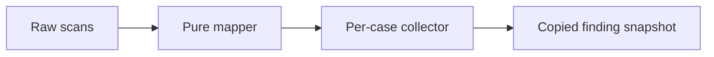

# Lesson 9: Accessibility mapping and collection

> “How does runner-core turn repeated raw axe observations into selected case evidence?” — Maya “Mapping Maven” Moore, Developer

`mapAccessibilityFindings` is pure: it maps violations into result-model finding shapes, retaining selected node and related-node evidence. It does not scan, validate arbitrary JSON, or store history.

`createAccessibilityFindingCollector` is stateful: a caller owns one collector per case. It groups by exact URL and description, keeps first-seen finding metadata, and appends newly observed problematic markup while updating counts.

Scan history also retains raw result references and is not protected-value safe. Redaction must exist before protected environment values are allowed into execution.

## Try it

Compare two scans with the same URL, description, and markup but different selectors. Predict what the collector retains.

## You are ready when

- You can distinguish mapping from collection.
- You understand first-observation retention and the current redaction gap.

