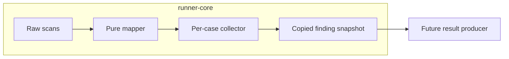

# Lesson 9: Accessibility mapping and collection

> “How does runner-core turn repeated raw axe observations into selected case evidence?” — Maya “Mapping Maven” Moore, Developer

[← Previous: accessibility scans](08-accessibility-scans.md) · [Course outline](../README.md) · [Next: structure and verification →](10-structure-and-verification.md)

`mapAccessibilityFindings` is pure: it maps violations into result-model finding shapes, retaining selected node and related-node evidence. It does not scan, validate arbitrary JSON, or store history.

`createAccessibilityFindingCollector` is stateful: a caller owns one collector per case. It groups by exact URL and description, keeps first-seen finding metadata, and appends newly observed problematic markup while updating counts.

Protected `executeCase` calls redact retained automatic findings and scan history, and direct scans can redact values supplied by their caller. Other APIs still need an explicit protected-value boundary before they can be treated as secret-safe.

## Try it

Compare two scans with the same URL, description, and markup but different selectors. Predict what the collector retains.

## You are ready when

- You can distinguish mapping from collection.
- You understand first-observation retention and the current redaction gap.

[← Previous: accessibility scans](08-accessibility-scans.md) · [Course outline](../README.md) · [Next: structure and verification →](10-structure-and-verification.md)
