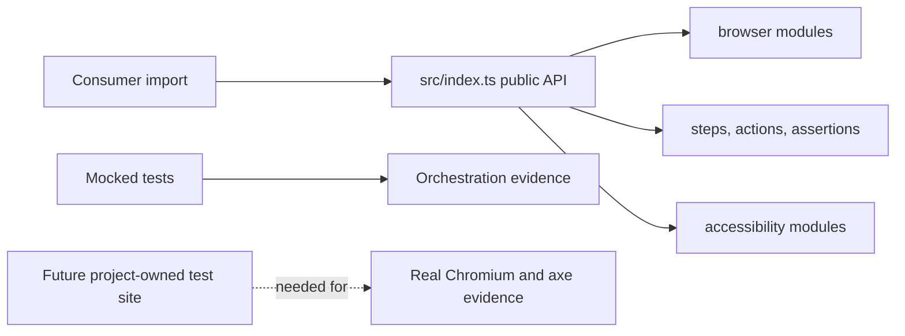

# Lesson 10: Package structure and verification

> “How can a reviewer find the right runner-core code and judge what its tests prove?” — Tess “Test Tracker” Turner, Developer

[← Previous: accessibility evidence](09-accessibility-evidence.md) · [Course outline](../README.md) · [Next: public API anatomy →](11-public-api.md)

The public [`src/index.ts`](../../../../packages/runner-core/src/index.ts) re-exports the supported API. Internals are grouped by responsibility: `browser/`, `actions/`, `steps/`, and `accessibility/`, with focused locator, wait, and assertion modules. Consumers import `@stagehand/runner-core`, not internal paths.

Run `npm test --workspace @stagehand/runner-core`. The owner's development-container run passed 172 mocked-browser tests. These tests use browser and axe doubles, so they verify orchestration, mapping, error handling, and cleanup logic without proving successful real Chromium/axe behaviour.

Actual Chromium/axe testing remains deferred until Stagehand has a project-owned test site. Historical runs and owner-reported CI evidence must remain labelled as historical or owner-reported.

The upper row shows how consumers reach supported APIs. The lower row separates what the current doubles prove from the real-browser evidence that remains deferred.

## Try it

Choose one failure test. State exactly what it proves and one browser behaviour it cannot prove.

## You are ready when

- You can locate each responsibility without importing an internal subpath.
- You can distinguish mocked verification, CI evidence, and real-browser evidence.

[← Previous: accessibility evidence](09-accessibility-evidence.md) · [Course outline](../README.md) · [Next: public API anatomy →](11-public-api.md)
