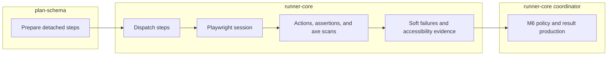

# Course: Understanding `@stagehand/runner-core`

This course teaches how Stagehand controls a browser session, executes validated steps, and gathers accessibility observations. The [package README](../../../packages/runner-core/README.md) is the detailed API reference.

## In this course you will learn

- How one browser run manages isolated case sessions and cleanup.
- How locators, waits, actions, assertions, and step dispatch work together.
- How variables, selected data sets, and shared steps are prepared before case-step dispatch.
- How accessibility settings, scans, mapping, and collection remain separate responsibilities.

## Do I need this course?

- [ ] I am changing browser lifecycle or case-session behaviour.
- [ ] I am adding or reviewing an action, assertion, wait, or locator.
- [ ] I need to understand hard versus soft failures.
- [ ] I am working on axe scanning or retained accessibility evidence.

## Current boundary

Runner-core manages Playwright Chromium, isolated case sessions, the current action/assertion vocabulary, automatic eligible-step scans, finding mapping/collection, and case preparation with optional selected data sets, shared-step expansion, and an injected protected-value environment map before dispatch. Its browser-free helper can prepare a caller-supplied list of cases before startup. `executePlanRun` coordinates prepared cases sequentially and `createResultDocument` produces a checked in-memory result document. For protected `executeCase` calls, returned soft failures and retained automatic accessibility findings and scan history are redacted. Direct scans can also redact caller-supplied protected values. `process.env`, plan-file loading, result-file writing, and CLI integration remain future work. The owner reports that current development-container test execution passed. Actual Chromium/axe assessment tests remain deferred until Stagehand has a project-owned test site.

Runner-core owns browser work, evidence gathering, outcome policy, and in-memory result production. It receives prepared inputs from `plan-schema`; plan-file loading, result-file writing, and CLI integration remain outside this package.

## Lessons

1. [Browser lifecycle](Lessons/01-browser-lifecycle.md)
2. [Locators](Lessons/02-locators.md)
3. [Waits](Lessons/03-waits.md)
4. [Actions](Lessons/04-actions.md)
5. [Assertions](Lessons/05-assertions.md)
6. [Step dispatch](Lessons/06-step-dispatch.md)
7. [Case preparation](Lessons/07-case-preparation.md)
8. [Accessibility settings and scans](Lessons/08-accessibility-scans.md)
9. [Accessibility mapping and collection](Lessons/09-accessibility-evidence.md)
10. [Package structure and verification](Lessons/10-structure-and-verification.md)
11. [Public API anatomy](Lessons/11-public-api.md)

Finish with the [course skill check](quiz.md).
