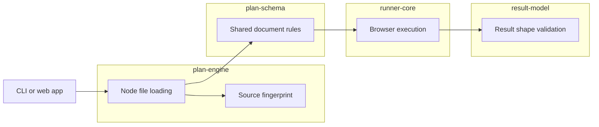

# Lesson 2: Package architecture

> “Why is Stagehand divided into apps and reusable packages instead of one large project?” — Monica “Module Mapper” Morgan, Developer

[← Previous: repository collaboration](01-repository-collaboration.md) · [Phase outline](../README.md) · [Next: development environment →](03-development-environment.md)

A monorepo stores related apps and packages together while keeping responsibility boundaries. Apps provide user-facing entry points; packages provide reusable contracts and behaviour.

The important boundary is dependency direction: shared contracts should not depend on browser or filesystem code. For example, `plan-schema` remains usable by Node and browser consumers, while `plan-engine` owns Node file access and `runner-core` owns browser execution.

Each implemented package has one public front door: its root import, such as `@stagehand/plan-schema`. Other packages may use what that front door exports, but must not reach into its private source folders. This keeps an internal reorganization from unexpectedly breaking another package.

The arrows show permitted hand-offs, not that the full app flow is complete today. Shared rules stay free of Node filesystem and Playwright browser code so more than one app can use them.

Stagehand checks this boundary with `npm run test:package-boundaries`. The check reads the implemented packages' manifests and source imports. It catches a missing declared dependency, a dependency pointing in the wrong direction, or an attempt to import another package's internal file. It does not run a browser or prove that a test plan works; that is a different kind of check. The accepted package rules are recorded in [TE-002](../../../Planning/Backlog/technical-enablers/te-002-reusable-node.js-typescript-package-structure.md).

## Try it

Place a new filesystem containment check, JSON contract rule, and browser click implementation into the package that should own each one.

## You are ready when

- You can explain why a monorepo does not mean one undivided codebase.
- You can choose a package by responsibility rather than convenience.
- You can explain why another package should use a public import instead of an internal source file.

[← Previous: repository collaboration](01-repository-collaboration.md) · [Phase outline](../README.md) · [Next: development environment →](03-development-environment.md)
