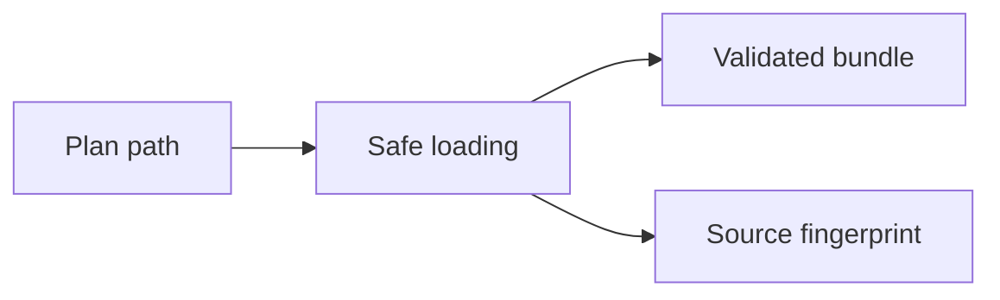

# Lesson 6: Plan loading and source identity

> “How are plan files loaded safely and tied to the exact source that was read?” — Lena “Loader Lookout” Liu, Developer

`plan-engine` reads a plan and only its referenced cases, checks real filesystem containment, validates the parsed bundle, and calculates a `sha256-v1` fingerprint from exact bytes.

The fingerprint changes when source bytes change, even if the parsed JSON meaning stays the same. Loading does not execute steps.

## Try it

Explain why normalized path matching and canonical filesystem containment are both required.

## You are ready when

- You can describe the loader's output and safety boundary.
- You can explain exact-byte fingerprinting.

