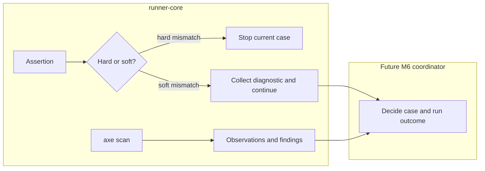

# Lesson 9: Assertions and accessibility

> “How does Stagehand check page content and accessibility without confusing observations with outcomes?” — Asha “Assertion Auditor” Ali, Developer

Text, HTML, and input-value assertions compare exact locale-selected strings. Hard failures stop a case step; recognized soft failures return diagnostics and permit continuation.

Accessibility scanning is optional. Completed axe analysis may contain violations or incomplete observations, so “completed” does not mean “passed.” Runner-core maps and collects selected evidence, while M6 will decide how `failOnViolation` affects outcomes.

Assertions and scans produce different kinds of facts. M6 policy will decide how those facts affect the final case and run status.

## Try it

Compare a soft text mismatch, an axe violation, and an axe adapter rejection. Explain why they are three different events.

## You are ready when

- You can explain hard versus soft assertions.
- You can separate scan execution, findings, and outcome policy.

