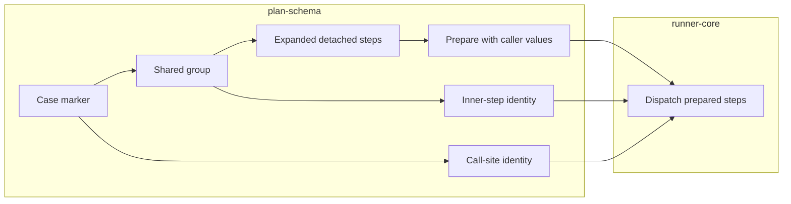

# Lesson 11: Shared steps

> “How can cases reuse behaviour without creating an invisible maze of nested calls?” — Sharon “Shared-step Sherpa” Shaw, Developer

[← Previous: variables data sets](10-variables-data-sets.md) · [Phase outline](../README.md) · [Next: errors policy →](12-errors-policy.md)

The accepted MVP direction is one-level shared steps with stable IDs. A plan declares `sharedSteps` as an object keyed by ID, and a case uses `{ "action": "sharedSteps", "id": "..." }`. Validation rejects unknown calls, calls inside shared steps, and private variable definitions inside shared steps. Expansion replaces a marker with detached steps and retains the call-site, shared-step ID, and inner-step identity. Preparation resolves those copied steps with the calling case's variables and selected data set. Runner-core then dispatches the prepared steps in order. Shared steps have no private parameters or defaults.

Think of a shared group as a reusable scene inserted into the caller's script, not a separate program. Diagnostics retain both the call site and inner-step identity for preparation errors, hard step errors, and soft assertion failures. M6 now aggregates the case outcomes; serializing shared-step identity into result documents remains later work.

The group contributes reusable steps, but the case remains the owner of the values and the error trail.

## Try it

Sketch one case calling a sign-in group. Mark the caller context and the identity needed if the group's second step fails.

## You are ready when

- You can explain the one-level restriction.
- You can distinguish shared steps from loops, which are deferred beyond MVP.
- You can explain how the caller and inner-step identity survive expansion and dispatch.

[← Previous: variables data sets](10-variables-data-sets.md) · [Phase outline](../README.md) · [Next: errors policy →](12-errors-policy.md)
