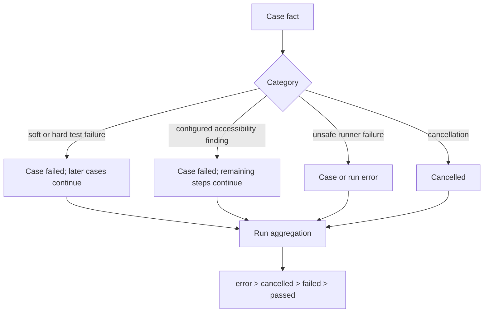

# Lesson 12: Errors and execution policy

> “How should one failure affect its step, case, independent cases, and the final run?” — Erin “Error Examiner” Evans, Developer

[← Previous: shared steps](11-shared-steps.md) · [Phase outline](../README.md) · [Next: integration review →](13-integration-review.md)

An error model preserves what failed, where it failed, and the original cause. Execution policy decides continuation and status. These are related but not identical: recording a browser error does not itself say whether another case should run.

M6 owns timeout, cancellation, cleanup, status mapping, aggregation, and preservation of primary/secondary failures. Cleanup errors must not erase the original failure. The initial policy lets independent cases continue after a hard case failure, keeps accessibility findings non-blocking even when they fail the case, and gives run outcomes this order: `error`, `cancelled`, `failed`, then `passed`. Early execution stays sequential. The coordinator receives cancellation through an `AbortSignal`, which is JavaScript's standard way to request that work stop.

| Situation | Case effect | Run effect |
| --- | --- | --- |
| Soft assertion | Continue steps; case fails. | `failed` unless a higher outcome occurs. |
| Hard assertion | Stop the case; later independent cases continue. | `failed` unless a higher outcome occurs. |
| Configured accessibility finding | Continue steps; case fails. | `failed` unless a higher outcome occurs. |
| Browser, axe, cleanup, or output error | Stop affected work safely. | `error`. |
| Cancellation before a new case | Do not start that case or later cases. | `cancelled` unless an error occurred. |

If cleanup adds a second problem after an earlier failure, the first failure stays visible as the primary cause. The cleanup problem is retained as secondary context rather than overwriting it.

This is the initial M6 policy. The coordinator now applies it to sequential prepared cases, and the adapter now makes in-memory result documents. Report files, CLI behaviour, active-work interruption, and concurrency remain later work.

`runner-core` now has a small browser-free `determineCaseOutcome` helper for this decision. It receives already-known facts and returns a case status plus the category that decided it. It does not run a browser, aggregate a run, or write result JSON.

`summarizeRunOutcome` then counts completed case statuses and applies the same priority to the whole run. A preflight error or cancellation before any case starts is supplied separately, because no completed case can represent it.

Timing uses a monotonic clock: a steadily increasing stopwatch, rather than a calendar clock that can change. Whole-run elapsed time begins before preflight and ends after browser/session cleanup, before report writing. Active-case time begins immediately before the first step and ends when dispatch ends; it includes waits and automatic scans but excludes preparation, browser/session setup, queue time, and cleanup. The accepted active-case default is 10 minutes, but this slice only measures time; it does not enforce that limit.

The cancellation building block checks an `AbortSignal` before starting each item of sequential work. An `AbortSignal` is a simple JavaScript stop-request flag: it says not to begin the next case, but it does not forcibly interrupt work already under way. The cleanup building block always attempts cleanup. If execution and cleanup both fail, it keeps the original failure as the primary problem and retains the cleanup failure as secondary context.

`executePlanRun` is the first coordinator. It prepares every selected case before Chromium starts, then runs prepared cases one at a time in separate browser sessions. It uses the outcome, timing, cancellation, and cleanup helpers, then returns an in-memory summary. `createResultDocument` converts that summary into a checked result document, using safe operational-error messages and a final redaction pass for supplied protected values. Neither helper writes files, offers CLI commands, interrupts an active case, or runs cases in parallel.

## Try it

Classify a locator timeout, a failed cleanup, and a cancelled run. Identify the diagnostic facts and the policy decisions for each.

## You are ready when

- You can separate error information from outcome policy.
- You know why independent cases may continue after a recoverable case failure.
- You know why a cancellation request stops new work rather than erasing completed work.

[← Previous: shared steps](11-shared-steps.md) · [Phase outline](../README.md) · [Next: integration review →](13-integration-review.md)
