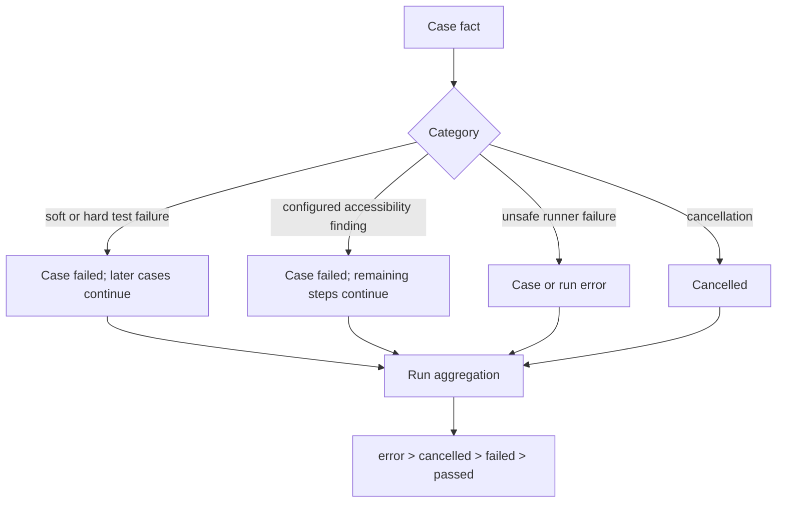

# Lesson 12: Errors and execution policy

> “How should one failure affect its step, case, independent cases, and the final run?” — Erin “Error Examiner” Evans, Developer

[← Previous: shared steps](11-shared-steps.md) · [Phase outline](../README.md) · [Next: integration review →](13-integration-review.md)

An error model preserves what failed, where it failed, and the original cause. Execution policy decides continuation and status. These are related but not identical: recording a browser error does not itself say whether another case should run.

M6 owns timeout, cancellation, cleanup, status mapping, aggregation, and preservation of primary/secondary failures. Cleanup errors must not erase the original failure. The initial policy lets independent cases continue after a hard case failure, keeps accessibility findings non-blocking even when they fail the case, and gives run outcomes this order: `error`, `cancelled`, `failed`, then `passed`. Early execution stays sequential. A future coordinator will receive cancellation through an `AbortSignal`, which is JavaScript's standard way to request that work stop.

This is the initial M6 policy, not a claim that a complete coordinator already enforces it.

## Try it

Classify a locator timeout, a failed cleanup, and a cancelled run. Identify the diagnostic facts and the policy decisions for each.

## You are ready when

- You can separate error information from outcome policy.
- You know why independent cases may continue after a recoverable case failure.

[← Previous: shared steps](11-shared-steps.md) · [Phase outline](../README.md) · [Next: integration review →](13-integration-review.md)
