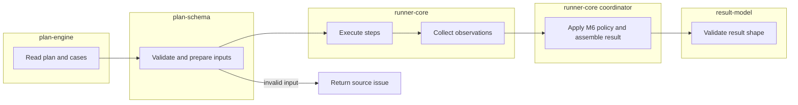

# Lesson 13: Phase integration review

> “How do we know the Phase 1 pieces form one coherent foundation rather than separate demos?” — Iris “Integration Inspector” Ingram, Developer

[← Previous: errors policy](12-errors-policy.md) · [Phase outline](../README.md) · [Next: course skill check →](../quiz.md)

Integration review follows data across boundaries: authored JSON → validation → safe loading → preparation → browser dispatch → observations → result shape. Each hand-off must preserve identity, errors, and documented scope.

The first M7 walkthrough is an executable, synthetic example. `npm run test:phase1-integration` loads a plan file and case with `plan-engine`, passes the loaded case to `runner-core` with a mocked browser, then checks the final in-memory result with `result-model`. It uses public package interfaces, so it reveals a broken hand-off without creating a production dependency between those packages.

Its companion invalid-case example stops at plan-engine. It returns the schema location `/caseFiles/0/steps` and the original `cases/bad.json` reference; the mocked Chromium launch is never called. In other words, invalid input does not reach the browser hand-off. This is still a test-only connection, not a production plan-file runner.

`npm run test:package-boundaries` checks a different integration concern: whether the implemented packages remain connected in the permitted direction. It confirms that plan-schema, plan-engine, result-model, and runner-core each have one public root entry point, and rejects an undeclared dependency or an import of another package's internal file. This protects the package seams; it does not replace the synthetic walkthrough or a real-browser assessment.

Several pieces remain planned: plan-file-to-coordinator orchestration, CLI protected-value boundaries, result-file writing, and CLI exit behaviour. The walkthrough connects packages only inside a test; it is not a production orchestrator. `executeCase` can use a caller-supplied protected-value map and redact returned soft failures and retained automatic accessibility evidence, without reading `process.env`; a direct scan can redact values its caller supplies. Shared steps now expand and execute at the case-session boundary, but that is not yet full result traceability. A coherent foundation states these gaps plainly.

M7 completes this Phase 1 foundation. Its clean development-container verification checks package boundaries, package suites, and the mocked walkthrough, but it does not turn those doubles into real Chromium/axe evidence. The next learning phase moves to the local editor, while CLI execution and reporting remain later roadmap work.

## Try it

Trace one case through the diagram and name the package responsible at each hand-off.

## You are ready when

- You can explain the complete intended flow and current gaps.
- You can spot a responsibility placed in the wrong package.
- You can distinguish a package-boundary check from a browser-execution check.

[← Previous: errors policy](12-errors-policy.md) · [Phase outline](../README.md) · [Next: course skill check →](../quiz.md)
