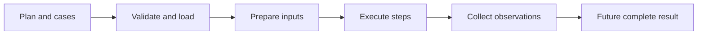

# Lesson 13: Phase integration review

> “How do we know the Phase 1 pieces form one coherent foundation rather than separate demos?” — Iris “Integration Inspector” Ingram, Developer

Integration review follows data across boundaries: authored JSON → validation → safe loading → preparation → browser dispatch → observations → result shape. Each hand-off must preserve identity, errors, and documented scope.

Several pieces remain planned: full orchestration, data-set selection, shared steps, protected values, and M6 policy. A coherent foundation states these gaps plainly.

## Try it

Trace one case through the diagram and name the package responsible at each hand-off.

## You are ready when

- You can explain the complete intended flow and current gaps.
- You can spot a responsibility placed in the wrong package.
