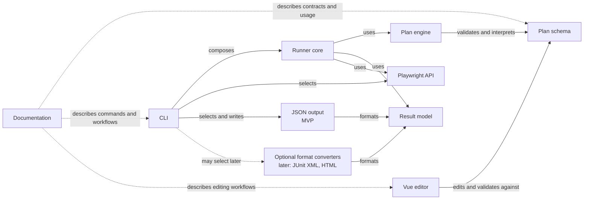

# Initial component dependency graph

This diagram records the current agreed starting design for M1; other architecture details remain subject to review. Stagehand currently targets Playwright only, so the runner core depends directly on Playwright. There is no separate browser adapter or adapter-neutral interface in the proposed MVP architecture.

## How to read it

- A solid arrow points from a component to something it depends on or uses.
- The dashed arrows are documentation relationships, not code dependencies.
- The schema and result model are shared contracts. They should not depend on the runner, CLI, editor, or Playwright.
- The runner core depends directly on Playwright. This keeps the MVP architecture simpler while Playwright is the only supported browser automation library.
- The common result model is the source for reports. The MVP supports JSON output; optional converters for formats such as JUnit-compatible XML and HTML are later candidates.
- The CLI owns command-line input/output, calls the runner core, selects an output, and writes it. The selected reporter formats the common result model.
- The editor consumes the shared schema so its accepted plan format stays aligned with the runner.

During M1, confirm this direct dependency and the exact boundary between the plan engine and runner core. Revisit a separate adapter only if another browser automation library becomes an actual requirement.
