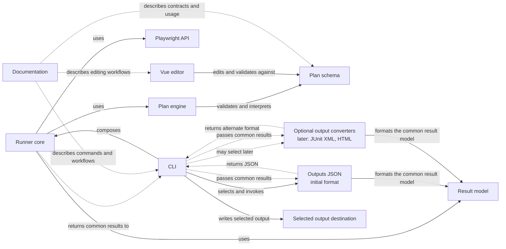

# Initial component dependency graph

This diagram records the current agreed starting design for M1; other architecture details remain subject to review. Stagehand currently targets Playwright only, so the runner core depends directly on Playwright. There is no separate browser adapter or adapter-neutral interface in the proposed MVP architecture.

## How to read it

- A solid arrow shows a dependency or call; dotted arrows show returned or passed result data. The labels state the relationship.
- Dotted arrows from documentation show documentation relationships, not code dependencies.
- The schema and result model are shared contracts. They should not depend on the runner, CLI, editor, or Playwright.
- The runner core depends directly on Playwright. This keeps the MVP architecture simpler while Playwright is the only supported browser automation library.
- The runner core returns the common result model to the CLI. JSON is the initial output format: the CLI selects the `Outputs JSON` formatter, passes it the common result model, receives formatted JSON, and writes the selected output to its destination. This formatter belongs to the provisionally separate reporters package.
- Optional converters may later format the same common result model as JUnit-compatible XML, HTML, or another output type.
- The CLI owns command-line input/output and calls the runner core. It does not select Playwright; the runner core owns execution and uses Playwright.
- The editor consumes the shared schema so its accepted plan format stays aligned with the runner.

The accepted M1 direction is for runner core to depend directly on Playwright and use the plan engine to interpret plans. Refine the exact engine/core boundary during implementation if concrete needs emerge. Revisit a separate browser adapter only if another browser automation library becomes an actual requirement.
